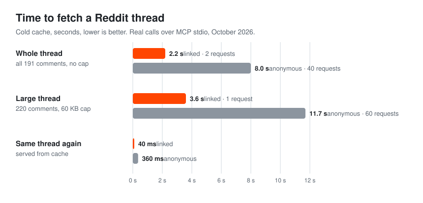
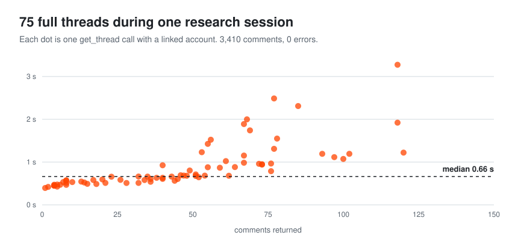

<p align="center">
  
</p>

# reddit-native-mcp

An MCP server that fetches whole Reddit threads for your AI agent, including the replies hidden behind "load more comments". A 191-comment thread comes back complete in 2.2 s with a linked account, or 8 s logged out. No API key, no app registration, no headless browser.

```bash
claude mcp add --transport stdio --scope user reddit-native -- uvx --from git+https://github.com/giri256/reddit-native-mcp reddit-native-mcp
```

Works with Claude Code, Claude Desktop, Cursor, opencode and any other MCP client. Unofficial and not affiliated with Reddit, Inc. (see [Disclaimer](#disclaimer)).

## Speed

<p align="center">
  
</p>

Most of the time goes into expanding collapsed replies. Logged out, every "load more" link costs a separate request, so a big thread takes dozens. With a linked account the server reads Reddit's JSON API, which returns nearly the whole tree in one or two requests. That's why linked reads are 3–4× faster. Results are cached for 3 minutes, so follow-up questions about the same thread come back in milliseconds.

<p align="center">
  
</p>

The second chart is one real session: I used the server to research how MCP projects get announced on Reddit. That took 138 tool calls with no errors. They read 3,634 posts and 75 full threads (3,410 comments), and a typical thread took 0.66 s. Searches are slower (5–9 s for 100 results) because Reddit serves search results in small pages.

All numbers are wall-clock time measured by an MCP client over stdio on a home connection, October 2026. Server startup adds 1.6–2.5 s once per session.

## What it does differently

Most Reddit tools for agents return the post plus a handful of top-level comments, but on Reddit the useful answer is often six replies deep. This server keeps expanding until it has the whole tree or reaches the size cap you set. When it does stop early, it says so and lists the ids it skipped.

`format="text"` returns the thread as an indented outline instead of JSON, about 22% smaller, so more comments fit in the context window. `find_posts` and `find_similar` cover discovery: several searches merged and ranked, or "find other posts about this one".

The client is honest. It sends a User-Agent that names the tool, doesn't rotate fake browser identities or try to get around bot checks, and keeps to Reddit's rate budget. If Reddit refuses a request, you get the error.

Linking an account is optional and works like `yt-dlp --cookies-from-browser`: the server reuses the Reddit login from a browser you're already signed in to. That's what makes reads faster, and it also turns on the posting tools.

## Tools

| Tool | |
|---|---|
| `get_thread` | Post and full comment tree from any post or comment URL, share link, `redd.it` link or id. Sort, depth, size cap, `format="text"`. |
| `search_posts` | A subreddit feed (hot/new/top/rising) or a Reddit search, sitewide, in one subreddit or by author, with paging. |
| `find_posts` | Several searches on a topic, sitewide and in chosen subreddits, merged and ranked. Optionally scans posts too new to be indexed. |
| `find_similar` | Other posts about the same thing, matched by shared link or title terms, each with the reason it matched. |
| `account_status`, `link_account` | Show or link the Reddit account. |
| `get_post_requirements` | A community's allowed post types, flairs and rules. |
| `create_post`, `edit_post`, `set_post_options`, `delete_post` | Post as the linked account: text, link, image, gallery or video. |

Reading works anonymously. Clients that support MCP dialogs (Claude Code) ask before the server touches your account.

## Install

Python 3.10+. With [uv](https://docs.astral.sh/uv/) there is nothing to clone; the `claude mcp add` line above is the whole setup. The first launch builds the package, so if your client times out on that first start, run the `uvx …` command once in a terminal and then restart the client.

For other clients:

```json
{
  "mcpServers": {
    "reddit-native": {
      "command": "uvx",
      "args": ["--from", "git+https://github.com/giri256/reddit-native-mcp", "reddit-native-mcp"]
    }
  }
}
```

opencode uses `"mcp": { "reddit-native": { "type": "local", "command": ["uvx", "--from", "git+https://github.com/giri256/reddit-native-mcp", "reddit-native-mcp"] } }`.

From source: `git clone`, then `python -m venv .venv && .venv/bin/pip install -e .`, and point your client at `.venv/bin/reddit-native-mcp`.

## Linking an account

Optional. In Claude Code, ask the agent to link your account (or to post something). A dialog lists the browser profiles that are signed in to Reddit, plus a "stay anonymous" choice. Clients without dialogs call `link_account()` and then `link_account(source="firefox")` with the profile you pick.

From a terminal you can use `reddit-native-mcp login`, `login brave:Default`, `login --window`, `status` and `logout`. To configure it instead, set `REDDIT_NATIVE_MCP_COOKIES_FROM_BROWSER=firefox`, or set `REDDIT_NATIVE_MCP_ANONYMOUS=1` to never use an account.

Supported browsers: Brave, Chrome, Chromium, Edge, Opera, Vivaldi, Whale and Firefox. Only reddit.com cookies are kept, in `~/.config/reddit-native-mcp/session.json` (mode 0600).

## Limits

Logged out, Reddit allows roughly 200 requests every few minutes; the tools warn you before you run out. Logged-out reads can't see NSFW, quarantined or private content. The server parses Reddit's own pages and JSON, so a markup change on Reddit's side can break parsing until the fixtures are re-recorded (`scripts/record_native_fixtures.py`).

## Development

```bash
.venv/bin/python -m unittest discover -s tests     # 107 offline tests, ~4 s
.venv/bin/python scripts/live_check_native.py      # live end-to-end check over stdio, ~30 s
```

## Disclaimer

This is an independent project. It is not affiliated with, endorsed by or sponsored by Reddit, Inc.; "Reddit" is their trademark and is used only to say what the software works with.

You are responsible for how you use it, including Reddit's [User Agreement](https://redditinc.com/policies/user-agreement) and [Data API Terms](https://redditinc.com/policies/data-api-terms), subreddit rules, and the laws that apply to you (data protection such as GDPR/CCPA, and copyright). The tool is meant for one person's assistant reading Reddit at human-ish volume. Don't use it for bulk scraping, dataset building, model training, reselling content, surveillance, de-anonymising people, harassment, vote manipulation or spam. The authors don't condone those uses and aren't responsible for them.

Anything done with a linked account happens under that account, and Reddit may rate-limit, restrict or ban accounts or IPs at its discretion. Posts are public and attributed to you. Reddit content can contain other people's personal information, so handle it lawfully. The session file never leaves your machine except in requests to reddit.com; treat it like a password, and `reddit-native-mcp logout` deletes it.

Provided "as is", without warranty of any kind, under the [MIT License](LICENSE). If you represent Reddit and have a concern, please open an issue.
