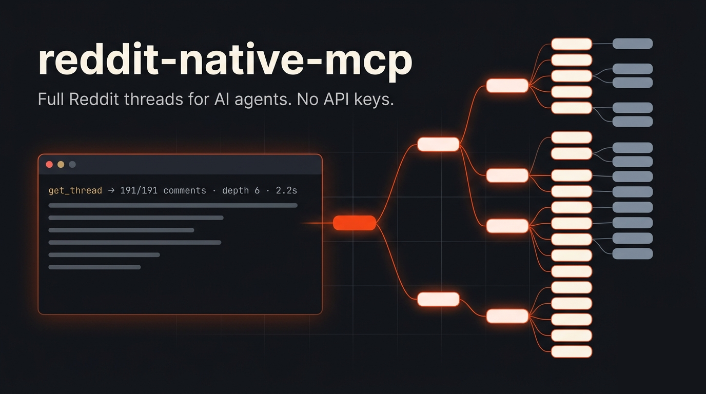

<p align="center">
  
</p>

# reddit-native-mcp

An MCP server that gives AI agents (Claude Code, Claude Desktop, Cursor, opencode, any MCP client) **whole Reddit threads**, with every comment, including the ones Reddit hides behind "load more replies". It reads reddit.com directly. You don't need an API key, an app registration or a headless browser.

```bash
claude mcp add --transport stdio --scope user reddit-native -- uvx --from git+https://github.com/giri256/reddit-native-mcp reddit-native-mcp
```

> Unofficial. Not affiliated with, endorsed by, or sponsored by Reddit, Inc. See [Disclaimer](#disclaimer).

## Why another Reddit MCP?

Most Reddit tools for agents return the post and a few top-level comments. On Reddit the useful part is often six replies deep, under a "12 more replies" link. reddit-native-mcp keeps expanding those links until it has the whole thread or reaches the size cap you set.

- **Complete comment trees.** A 202-comment thread comes back as all 191 comments Reddit still serves, nested 6 levels deep, in one call (Reddit's counter also includes removed and deleted comments).
- **Built for agents.** `format="text"` returns an indented outline instead of a JSON dump. It's about 22% smaller, so more comments fit in the context window. Output is size-capped, and truncation is explicit (`meta.truncated`, ids of the comments it left out).
- **Discovery, not just fetching.** `find_posts` runs several searches across Reddit and inside the subreddits you choose, then merges and ranks the results. `find_similar` takes one post and finds others that share its link or its topic.
- **Honest client.** It sends a User-Agent that names the tool, uses standard TLS, and keeps to Reddit's rate budget. It doesn't pretend to be a browser, rotate fake User-Agents or try to get past Reddit's bot checks. If Reddit says no, the tool tells you.
- **Optional account link, like `yt-dlp --cookies-from-browser`.** It can reuse the Reddit login of a browser you're already signed in to. That raises your rate limits, makes thread reads faster, and turns on posting tools (text, link, image, gallery and video posts). You never type a password or create an OAuth app.

## Benchmark

These are real numbers. To prepare this release I used the server to research how MCP projects are announced on Reddit. I drove it over real MCP stdio from a Python client and timed every call (October 2026, home connection, Python 3.14).

**Research run (linked account):**

| | |
|---|---|
| Tool calls | 138 (63 searches/feeds + 75 full threads), **0 errors** |
| Posts collected | 5,836 records → 3,634 unique posts |
| Comments read | 3,410 across 75 threads, using 80 Reddit requests |
| `get_thread` latency | median **0.66 s**, p90 1.6 s, max 3.3 s |
| `search_posts` (100 results) | median 8.9 s (Reddit search pages are small, so it pages several times) |

**Linked vs anonymous (cold cache):**

| Workload | Linked account | Anonymous |
|---|---|---|
| `get_thread`, 220-comment thread (default 60 KB cap) | **3.6 s** | 11.7 s |
| `get_thread`, whole 191-comment thread, no cap | **2.2 s** | 8.0 s (40 requests) |
| `get_thread` with `max_requests=1` | 220 comments | 25 comments |
| `search_posts`, top 100 of r/mcp this month | 6.3 s | 4.4 s |
| `find_posts`, 2 phrases × 2 subs | 3.5 s | 3.4 s |
| `find_similar` | 3.9 s | 4.5 s |
| Any repeat within 3 min (in-process cache) | 30–200 ms | 35–440 ms |

Server startup takes about 1.6–2.5 s. Search speed is the same in both modes. Thread reads are 3–4× faster with a linked account, because those go through Reddit's JSON API.

## Tools

| Tool | What it does |
|---|---|
| `get_thread(post, comment_id?, sort, max_depth, max_output_chars, max_requests, format)` | Fetches a post and its full comment tree. `post` accepts any post or comment URL, `/s/` share link, `redd.it` link, bare id or `t1_` id. Sorts: best/top/new/old/controversial/qa. |
| `search_posts(subreddit?, query?, author?, sort?, time_range?, limit, cursor?)` | Lists a subreddit feed (hot/new/top/rising/best) or runs a Reddit search (sitewide, in one subreddit, or by author). Pass the returned cursor to get the next page. |
| `find_posts(keywords, subreddits?, days, scan_days, max_results, sort)` | Finds posts on a topic: one Reddit search per phrase, sitewide and in each given subreddit, merged and ranked. It can also scan new posts that search hasn't indexed yet. |
| `find_similar(post, days, extra_keywords?, max_results)` | Finds other posts about the same thing, by shared link or by key title terms. Each result says why it matched. |
| `account_status()` | Shows the linked account (if any), whether its session is valid, and the remaining rate budget. |
| `link_account(source?)` | Links the Reddit login from a local browser profile. |
| `get_post_requirements(subreddit)` | Shows a community's allowed post types, flairs and rules. Check this before posting. |
| `create_post(...)` / `edit_post` / `set_post_options` / `delete_post` | Publishes and manages posts as the linked account. Posts can be text (with inline images), link, image, gallery or video. |

Reading works anonymously. The posting tools need a linked account, and MCP clients that support dialogs ask you before the server touches your account.

## Install

You need Python 3.10 or newer.

**With uv (no clone):**

```bash
uvx --from git+https://github.com/giri256/reddit-native-mcp reddit-native-mcp   # runs the stdio server
```

**From source:**

```bash
git clone https://github.com/giri256/reddit-native-mcp
cd reddit-native-mcp
python -m venv .venv && .venv/bin/pip install -e .
```

### Register with your client

**Claude Code**

```bash
claude mcp add --transport stdio --scope user reddit-native -- "$PWD/.venv/bin/reddit-native-mcp"
```

**Claude Desktop / Cursor / any JSON-configured client**

```json
{
  "mcpServers": {
    "reddit-native": {
      "command": "uvx",
      "args": ["--from", "git+https://github.com/giri256/reddit-native-mcp", "reddit-native-mcp"]
    }
  }
}
```

**opencode** (`~/.config/opencode/opencode.json`)

```json
{
  "mcp": {
    "reddit-native": { "type": "local", "command": ["/path/to/reddit-native-mcp/.venv/bin/reddit-native-mcp"] }
  }
}
```

## Linking a Reddit account (optional)

Linking is opt-in. Without it, everything read-only works anonymously.

- **In a client with MCP dialogs (Claude Code):** ask the agent to link your account, or just ask it to post. A dialog lists the browser profiles that are logged in to Reddit, plus *Don't link: stay anonymous*.
- **In a client without dialogs (e.g. opencode):** the agent calls `link_account()`, shows you the list, and calls `link_account(source="firefox")` or `link_account(source="brave:Default")` with your choice.
- **From a terminal:** `reddit-native-mcp login` (offers the logged-in profiles), `login brave[:Profile 1]`, `login --window` (log in in a separate window), `login --paste`, `status`, `logout`.
- **Config only:** set `REDDIT_NATIVE_MCP_COOKIES_FROM_BROWSER=firefox` (or `brave`, `chrome:Profile 1`, …) in the server's environment. Set `REDDIT_NATIVE_MCP_ANONYMOUS=1` to never use an account.

Supported browsers: Brave, Chrome, Chromium, Edge, Opera, Vivaldi, Whale and Firefox. The server keeps only reddit.com cookies, in `~/.config/reddit-native-mcp/session.json` (file mode 0600; override the folder with `REDDIT_NATIVE_MCP_HOME`). If Reddit later rejects the session, the server reads the same browser profile again. A running server picks up a new link without a restart.

## Examples

Ask your agent:

- "Read this whole thread and tell me what the top disagreements are: https://www.reddit.com/r/LocalLLaMA/comments/…"
- "Find posts from the last 30 days in r/selfhosted and r/homelab about Immich vs PhotoPrism, then summarise what long-term users say."
- "Here's a post. Find other threads about the same thing and check whether people reached the same conclusion."
- "Which MCP launch posts got the most engagement this year, and what did they have in common?" (that's how this README was planned)

## Limits and known behaviour

- Reddit allows about 200 anonymous requests every few minutes. A linked account gets a separate, larger JSON-API budget. When the budget runs low, the tools say so.
- Logged-out reads don't show NSFW, quarantined or private content.
- Reddit search returns small pages, so a 100-result search takes several requests (about 5–10 s).
- The server reads Reddit's own web and JSON responses. If Reddit changes its markup, parsing can break until the parser is updated (`scripts/record_native_fixtures.py` re-records the test fixtures).

## Development

```bash
.venv/bin/python -m unittest discover -s tests          # offline, 107 tests, ~4 s
.venv/bin/python scripts/live_check_native.py           # live end-to-end over real stdio, ~30 s, ~80 requests
.venv/bin/python scripts/record_native_fixtures.py      # re-record fixtures when Reddit's markup changes
```

Layout: `src/reddit_native_mcp/` holds `server.py` (MCP tools), `http.py` (client, rate budget, cache), `parse.py`/`shape.py` (Reddit markup → records), `thread.py` (comment-tree expansion), `jsonapi.py` (logged-in reads), `similar.py`, `links.py`, `auth.py`/`browser_cookies.py` (account link) and `write.py` (posting).

## Disclaimer

**Read this before you use the software.**

- **Unofficial project.** reddit-native-mcp is an independent open-source tool. It is not affiliated with, endorsed by, or sponsored by Reddit, Inc. "Reddit" is a trademark of Reddit, Inc. and is used here only to describe what the software works with.
- **Your responsibility.** You alone are responsible for how you use this software. That includes following [Reddit's User Agreement](https://redditinc.com/policies/user-agreement), its [Developer and Data API Terms](https://redditinc.com/policies/data-api-terms), any subreddit's rules, and the laws that apply to you (including data-protection laws such as the GDPR and CCPA, and copyright law).
- **No scraping endorsement.** The tool is meant for personal, interactive, low-volume use by one person's AI assistant. Don't use it for bulk scraping, building datasets, training machine-learning models, reselling Reddit content, surveillance, de-anonymising people, harassment, vote manipulation, spam or any other abuse. The authors don't condone those uses and are not responsible for them.
- **Account risk.** Using your browser session outside the browser, and posting through the posting tools, happen under your Reddit account. Reddit may rate-limit, restrict, suspend or ban accounts or IP addresses at its own discretion. You accept that risk. Anything the tool posts is public and attributed to you.
- **Personal data.** Reddit content can include personal information about other people. Collect only what you need, don't republish it out of context, and handle it lawfully.
- **Credentials stay local.** The account link copies reddit.com cookies from your own browser into a local file readable only by you. Nothing is sent anywhere except reddit.com. You should still treat that file like a password, and `reddit-native-mcp logout` deletes it.
- **No warranty.** The software is provided "as is", without warranty of any kind, as stated in the [MIT License](LICENSE). The authors and contributors are not liable for any claim, damages, account loss, data loss or other liability arising from its use.

If you represent Reddit and have concerns about this project, please open an issue.

## License

[MIT](LICENSE)
